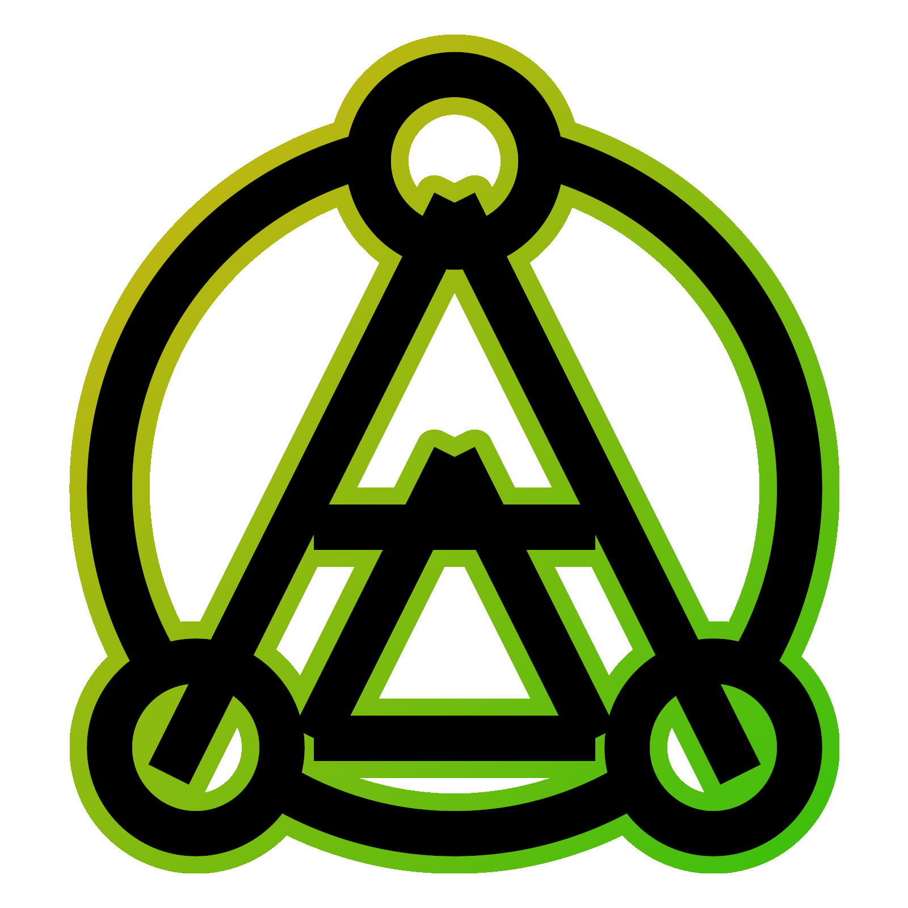
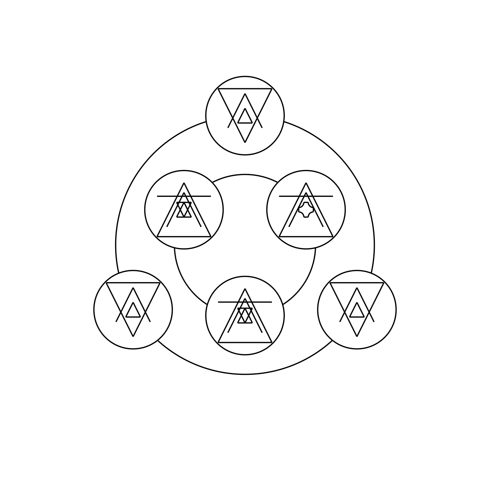

<div align="center">

</div>

# SIGIL MAY CRY

Sigil May Cry, ou SigilMC permet de dessiner en calligraphie sigillaire sans se casser le cul à déplacer des .png pixelisés. Les sigils sont crées vectoriellement, permettant une très haute définition.

## FAQ

> **C'est quoi, un sigil ?**

Ce dépôt n'est pas destiné à ceux qui ne savent pas de quoi il parle, pour des raisons qui seront évidentes pour certains, et pour mes proches : bonjour ! Comment ça va ? Il n'y a rien à voir ici ahahahah

> **Est-ce que je peux enfreindre les règles de base des Sigils ?**

**Non.** Trois arcanums par strophe, trois stophes par cercle, trois cercles par sigil, pas plus.

> **Je suis Sylkabe.**

Bonjour !

## Installer

### Via PIP
```
pip install sigilmc
```

### Via PIPX
```
pipx install sigilmc
```

## Options
- `-i` : Transforme l'entrée d'une formule de sigil à un fichier. Par exemple : `sigilmc -i exemples/feu.sigil` génèrera le sigil contenu dans le fichier.
- `-o FICHIER` : Enregistre le sigil dans le fichier défini. Formats supportés : .png, .svg et .gif
- `-s` : Active le mode Strophe qui permet de générer une strophe ou un arcanum seul, sans cercle, sur fond transparent.
- `-p ÉCHELLE` : Définit l'échelle de pixels du rendu, plus elle est haute, plus le rendu est de haute qualité. (Défaut : 16)

## Syntaxe

- Les arcanums d'une srophe sont séparés par un tiret (`-`)
- Les strophes d'un cercle sont séparées par un point-virgule (`;`)
- Les strophes peuvent être dupliquées à l'aide d'un astérisque (`*`)
- Les cercles d'un sigil sont séparés par un slash (`/`)

### Exemple

```
sigilmc "3 * liquide - augmenter - chaleur / 2 * air - augmenter - froid ; air - augmenter - taille"
```



## À faire
- Arcanums : 
  - [x] Corps
  - [x] Force
  - [x] Cycle perpétuel
- Ergonomie :
  - [x] Outil CLI
  - [x] Publication sur PyPi
- Fonctionnalités :
  - [x] Options d'export
  - [x] Entrée par fichier
    - [x] Format de fichier compréhensible
    - [ ] Possibilité de générer plusieurs sigils et de les exporter en masse
- Graphisme :
  - [ ] Adapter la taille des plus petits sigils
  - [ ] Se remonter les bretelles et faire un arcanum Cycle correct (ne sera jamais coché)
